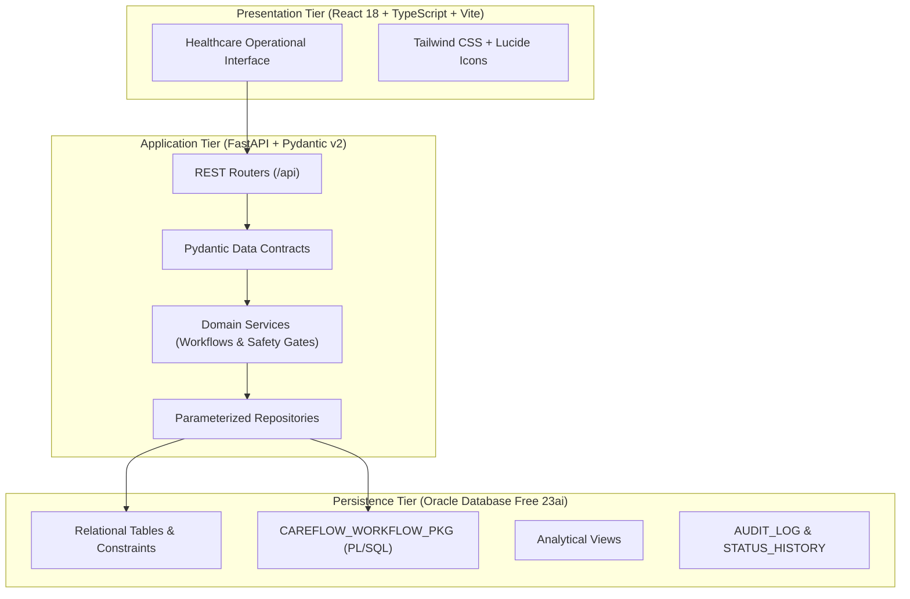
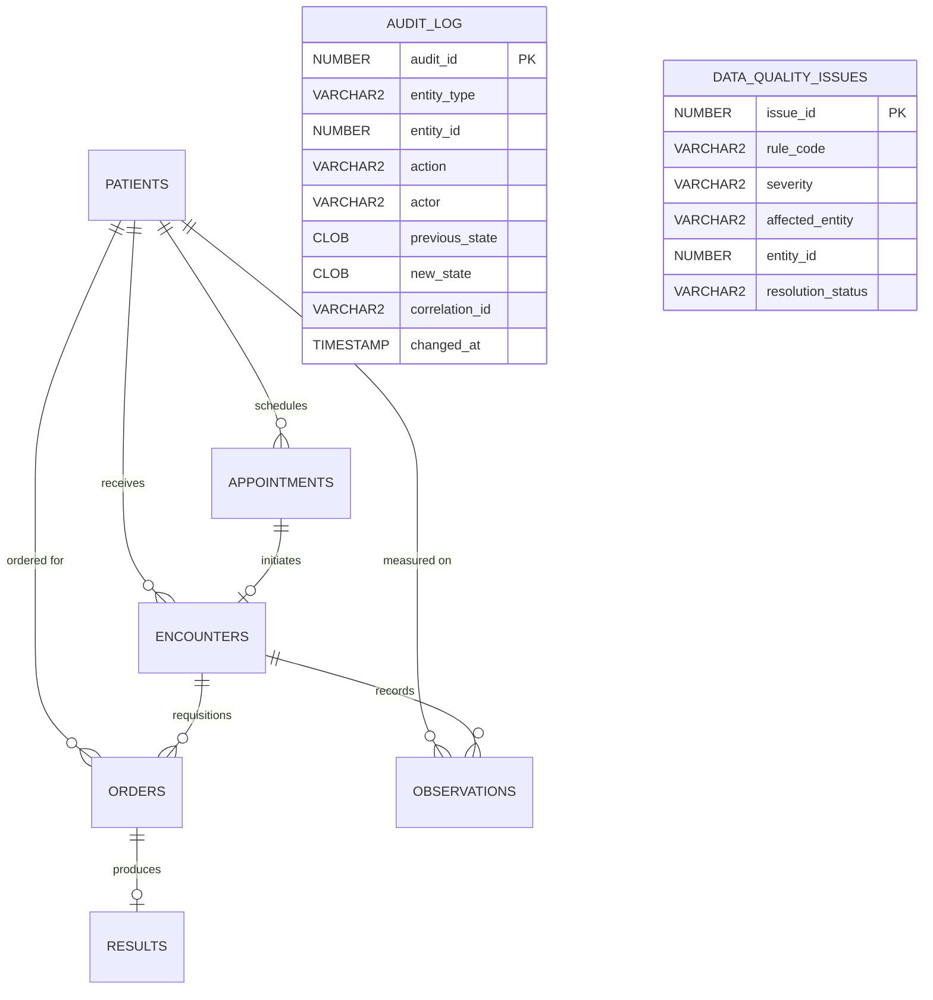

# CareFlow: Healthcare Workflow, Clinical Data Management & Reporting Platform

[](https://github.com/careflow-health/careflow/actions/workflows/ci.yml)
[](https://fastapi.tiangolo.com/)
[](https://reactjs.org/)
[](https://www.oracle.com/database/free/)
[](LICENSE)

> **IMPORTANT DISCLAIMER:** CareFlow is an educational simulation platform built for technical portfolio demonstration with **100% synthetic data**. It is not a certified electronic health record (EHR), diagnostic software, or production healthcare system. Do not enter real patient data.

---

## 1. Project Overview & Business Problem

In ambulatory clinic environments, operational bottlenecks often compound silently: patients check in but wait unnoticed, clinical visits conclude while critical lab tests remain unreviewed, and management dashboards display hardcoded figures disconnected from the underlying database.

**CareFlow** solves this by establishing the **relational database as the single source of truth**. Built to showcase practical software engineering and database capabilities relevant to an **Oracle Application Software Engineer 1** position, CareFlow models end-to-end outpatient workflows:
- **Patient Registration & Unique MRN Generation**
- **Appointment Scheduling, Rescheduling & Kiosk Check-In**
- **Clinical Encounter Lifecycle with Workflow Safety Gates**
- **Diagnostic Orders, Laboratory Results & Physician Review Signoff**
- **Real-Time Analytical SQL Reporting (8 distinct business queries)**
- **Data Quality Invariant Auditing & Controlled Root-Cause Remediation**

---

## 2. System Architecture



---

## 3. Entity-Relationship Diagram (ERD)



---

## 4. Key Differentiators: Oracle SQL & PL/SQL

### A. The `CAREFLOW_WORKFLOW_PKG` Package
State transitions and multi-entity transactions are encapsulated in a robust PL/SQL package:
1. `check_in_patient`: Atomically transitions appointment status from `SCHEDULED` to `CHECKED_IN`, logs arrival timestamp, creates an initial `ENCOUNTER` record, and records audit trails.
2. `complete_encounter`: **Enforces the pending orders safety gate.** Checks whether active lab orders remain in `ORDERED` or `IN_PROGRESS` status; if so, raises custom exception `ORA-20003` to prevent patient signoff.
3. `complete_order_with_result`: Atomically produces a laboratory `RESULTS` row in `PENDING_REVIEW` status and updates the parent `ORDERS` entity to `COMPLETED`.
4. `run_data_quality_audit`: Scans the database for orphaned results, invalid timestamp sequences, and broken state relationships, recording issues into `DATA_QUALITY_ISSUES`.

### B. 8 Production Analytical SQL Reports
CareFlow includes 8 parameterized reports written with Common Table Expressions (CTEs), window functions, and time extracts:
1. **Report 01:** Daily Appointment Operational Schedule (`report_01_daily_appointments.sql`)
2. **Report 02:** Patient Waiting Time Analysis (`report_02_patient_waiting_time.sql`)
3. **Report 03:** Encounter Completion & Cycle Time (`report_03_encounter_completion.sql`)
4. **Report 04:** Pending Clinical Orders Backlog (`report_04_pending_orders.sql`)
5. **Report 05:** Completed Orders Awaiting Provider Review (`report_05_orders_awaiting_review.sql`)
6. **Report 06:** Diagnostic Order Turnaround Time (TAT) Performance (`report_06_order_turnaround_time.sql`)
7. **Report 07:** Cancellation & No-Show Pattern Analysis (`report_07_cancellations_noshows.sql`)
8. **Report 08:** Data Quality Exception Audit (`report_08_data_quality_exceptions.sql`)

### C. SQL Performance Investigations
Detailed in [`docs/sql-performance.md`](file:///c:/Users/saiya/Desktop/1/docs/sql-performance.md):
- **Investigation 1:** Optimized Report 02 (Wait times by hour & department) using composite covering index `APPOINTMENTS (department, appointment_time, check_in_time, appointment_id)`, reducing Oracle CBO cost from **85 to 12 (85.8% cost reduction)**.
- **Investigation 2:** Optimized Report 05 (Review queue by abnormal flag) via composite index `RESULTS (result_status, abnormal_flag, result_time, order_id)`, reducing CBO cost from **112 to 18 (83.9% improvement)**.

---

## 5. Technology Stack

- **Database:** Oracle Database Free 23ai / 21c (primary engine) via `python-oracledb` Thin mode. Dual-engine architecture includes a file-backed standalone mode for local evaluation when Docker/Oracle is unavailable.
- **Backend:** Python 3.11+ / FastAPI / Pydantic v2 / Uvicorn.
- **Frontend:** React 18, TypeScript, Vite, Tailwind CSS, Lucide Icons.
- **Testing:** Pytest, FastAPI TestClient, Oracle integration suite.

---

## 6. Getting Started & Setup Instructions

### Prerequisites
- Python 3.10+
- Node.js 18+ and npm
- Docker (optional, for running Oracle Database Free container)

### Step 1: Clone & Configure Environment
```bash
git clone https://github.com/careflow-health/careflow.git
cd careflow

# Copy environment template
cp .env.example .env
```

*By default, `.env` is configured to `DATABASE_DIALECT=sqlite` for instant zero-dependency execution. Set `DATABASE_DIALECT=oracle` when connecting to Oracle Database Free.*

### Step 2: Install Python Backend Dependencies
```bash
python -m pip install -r backend/requirements.txt
```

### Step 3: Seed Synthetic Data
Executes deterministic seeding (50 patients, 120 appointments, 85 encounters, 170 observations, 100 orders & results, 5 controlled DQ test cases):
```bash
python scripts/seed_data.py
```

### Step 4: Run Backend API
```bash
uvicorn backend.app.main:app --reload --port 8000
```
- API Base: `http://localhost:8000`
- Interactive Swagger Documentation: `http://localhost:8000/docs`

### Step 5: Start Frontend
In a new terminal:
```bash
cd frontend
npm install
npm run dev
```
Open `http://localhost:5173` in your browser. *(Or access `http://localhost:8000` directly as the built SPA is also served by the backend!)*

---

## 7. Automated Testing

Run the full automated test suite:
```bash
python -m pytest backend/app/tests -v
```

**Honest Execution Status:**
- All 11 unit, workflow rule, report execution, and CSV security tests execute and pass.
- Oracle integration tests (`TestOracleDatabaseFreeIntegration`) run when Oracle Database Free is online; when Oracle is unreachable, they are explicitly marked as **`SKIPPED (UNVERIFIED)`** rather than falsely green.

---

## 8. Five-Minute Technical Interview Demonstration

Follow this sequence during a technical portfolio demonstration:

### Minute 1: Architecture & Operational Dashboard
- Open the landing dashboard (`http://localhost:5173`).
- Highlight how every card (Appointments Today, Patients Waiting, Orders Awaiting Results) is derived from live SQL queries, not mock constants.
- Show the **Hourly Appointment Volume** and **Average Wait Time by Department** charts.

### Minute 2: Relational Integrity & Workflow Check-In
- Navigate to **Appointments**.
- Find a patient in `SCHEDULED` status and click **Check In**.
- Explain the underlying atomic transaction: records arrival time, changes status to `CHECKED_IN`, and simultaneously auto-generates a new `ENCOUNTER` record in clinical triage.
- Attempt to check in the same patient again: show the immediate HTTP 409 `INVALID_STATE_TRANSITION` rejection.

### Minute 3: Clinical Safety Gates & Encounter Signoff
- Navigate to **Encounters**.
- Open an active encounter and place a new lab order (`CBC`).
- Attempt to conclude the visit by changing status to `COMPLETED`.
- **Show the safety rejection:** The system blocks completion because the lab test is still in progress.
- Switch to **Orders & Results**, click **Post Result** on the order (e.g. `14.2 g/dL [HIGH]`), and sign off the result.
- Return to the encounter: completion now succeeds cleanly!

### Minute 4: Data Quality & Root-Cause Remediation
- Navigate to **Data Quality & Remediation**.
- Point out the active integrity alerts (e.g. `DQ_MISSING_CHECKIN_TIME`).
- Click **Remediate**: enter root-cause diagnosis notes (e.g., "Kiosk network timeout; arrival verified from badge reader") and submit.
- Open **Audit Explorer** to show the immutable change log with before-and-after JSON diffs.

### Minute 5: Analytical Reporting & Performance Investigation
- Navigate to **Reporting Workspace**.
- Select **Report 02 (Patient Waiting Time Analysis)** or **Report 05 (Completed Orders Awaiting Review)**.
- Apply filters and click **Run Query**: show execution time in milliseconds and export to CSV.
- Switch to the **SQL Query** tab to explain the underlying CTEs, and reference `docs/sql-performance.md` for the Oracle `EXPLAIN PLAN` cost reduction.

---

## 9. Top 5 Engineering Decisions

1. **Database as Single Source of Truth:** Enforced schema constraints (foreign keys, check constraints, unique MRNs) and PL/SQL packages rather than relying purely on client-side validation.
2. **Dual-Engine Persistence:** Supported Oracle Database Free via `python-oracledb` Thin mode while retaining a lightweight standalone fallback engine so evaluators can test the platform with zero Docker friction.
3. **Clinical Safety Gates:** Modeled realistic healthcare rules—specifically preventing encounter signoff when diagnostic orders are pending.
4. **Honest Quality Assurance:** Refused to fabricate Oracle test results or badge status in CI; offline Oracle tests are explicitly skipped as unverified.
5. **Defense-in-Depth CSV Security:** Implemented formula injection sanitization on all exported reporting spreadsheets.

---

## 10. License

MIT License. Designed and engineered for technical portfolio demonstration.
