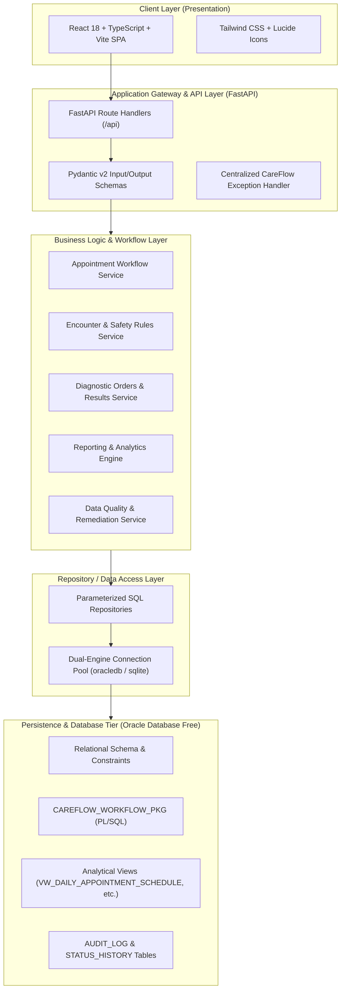

# CareFlow Architecture & Technical Design

## 1. System Overview

**CareFlow** is a simulated healthcare operations, clinical workflow, and operational reporting platform designed to demonstrate database-driven software engineering skills relevant to an **Oracle Application Software Engineer 1** position.

The platform coordinates the lifecycle of outpatient clinical care—from initial registration and appointment scheduling, through reception check-in, physician triage, diagnostic ordering, laboratory result processing, clinical review signoff, and operational reporting.

---

## 2. Layered Architecture Principles

CareFlow adheres strictly to enterprise separation of concerns:

1. **Presentation Layer (React + TypeScript):**
   - Strictly decoupled from database details; communicates entirely via strongly typed JSON REST endpoints.
   - Built with enterprise healthcare operational aesthetics: restrained color palettes, high-contrast badges, zero clutter, accessible keyboard navigation, and responsive layouts.

2. **API & Validation Layer (FastAPI + Pydantic v2):**
   - Route handlers contain zero business logic or raw queries; their responsibility is request validation, HTTP status codes, and routing.
   - Global exception handling maps domain exceptions (`WorkflowConflictException`, `ResourceNotFoundException`, `DataIntegrityException`) to RFC 7807-compatible JSON error responses.

3. **Service Layer (Domain & Business Workflow):**
   - Implements healthcare workflow state machines, state invariants, and cross-entity transactions.
   - Example: Ensuring an encounter cannot be marked `COMPLETED` if active laboratory orders remain in `ORDERED` or `IN_PROGRESS` status.

4. **Data Access Layer (Repository Pattern):**
   - Centralizes all SQL statements and parameter bindings.
   - Enforces parameterized queries to eliminate SQL injection vulnerabilities.
   - Dual-engine design supports **Oracle Database Free** (using `python-oracledb`) as the primary production engine, and provides a standalone fallback engine for lightweight local evaluation.

5. **Database Layer (Oracle SQL & PL/SQL):**
   - The relational database is the ultimate source of truth.
   - Invariants (foreign keys, check constraints, unique MRN constraints) are enforced at the schema boundary.
   - Complex state transitions are encapsulated in the PL/SQL package `CAREFLOW_WORKFLOW_PKG`.
