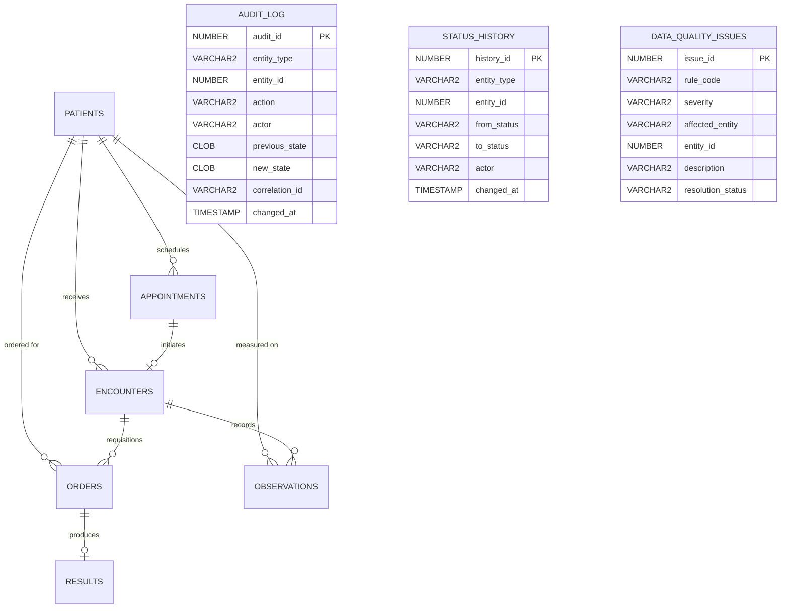

# CareFlow Relational Data Model & Schema Design

## 1. Entity-Relationship Diagram (ERD)

The relational schema implements core clinical operations, strict referential integrity, and complete audit tracking.

---

## 2. Table Specifications & Constraints

### 1. PATIENTS
Stores core simulated demographic and identifier records.
- `patient_id` (NUMBER, PK, Identity): Unique surrogate primary key.
- `mrn` (VARCHAR2(32), UNIQUE, NOT NULL): Medical Record Number (format: `MRN-YYYY-XXXXX`). Unique constraint enforced at database layer.
- `first_name`, `last_name` (VARCHAR2(100), NOT NULL): Synthetic names.
- `date_of_birth` (DATE, NOT NULL): Birth date for age calculations.
- `gender` (VARCHAR2(10)): Check constraint `IN ('FEMALE', 'MALE', 'OTHER', 'UNKNOWN')`.
- `status` (VARCHAR2(20)): Check constraint `IN ('ACTIVE', 'INACTIVE', 'MERGED')`.

### 2. APPOINTMENTS
Manages scheduling, arrivals, and cancellations.
- `appointment_id` (NUMBER, PK, Identity).
- `patient_id` (NUMBER, FK -> PATIENTS, NOT NULL).
- `appointment_time` (TIMESTAMP WITH TIME ZONE, NOT NULL).
- `department` (VARCHAR2(80), NOT NULL): Clinic department (Cardiology, Endocrinology, Family Medicine, Pediatrics, Urgent Care).
- `provider_name` (VARCHAR2(120), NOT NULL): Attending clinician.
- `status` (VARCHAR2(30), NOT NULL): Check constraint `IN ('SCHEDULED', 'CHECKED_IN', 'IN_PROGRESS', 'COMPLETED', 'CANCELLED', 'NO_SHOW')`.
- `check_in_time` (TIMESTAMP WITH TIME ZONE): Recorded when patient checks in at reception.

### 3. ENCOUNTERS
Represents the clinical visit and evaluation episode.
- `encounter_id` (NUMBER, PK, Identity).
- `patient_id` (NUMBER, FK -> PATIENTS, NOT NULL).
- `appointment_id` (NUMBER, FK -> APPOINTMENTS, Nullable for direct walk-ins).
- `status` (VARCHAR2(30), NOT NULL): Check constraint `IN ('OPEN', 'IN_PROGRESS', 'AWAITING_RESULTS', 'COMPLETED', 'CANCELLED')`.
- `start_time`, `end_time` (TIMESTAMP WITH TIME ZONE): Invariant check constraint `chk_enc_time_order CHECK (end_time IS NULL OR end_time >= start_time)`.
- `clinical_notes` (CLOB): Documentation of evaluation, diagnosis, and signoff.

### 4. OBSERVATIONS
Captures vital signs and physical observations.
- `observation_id` (NUMBER, PK, Identity).
- `encounter_id` (NUMBER, FK -> ENCOUNTERS, NOT NULL).
- `patient_id` (NUMBER, FK -> PATIENTS, NOT NULL).
- `observation_code` (VARCHAR2(30), NOT NULL): Vitals identifier (e.g. `BP_SYS`, `BP_DIA`, `HEART_RATE`, `TEMP`, `SPO2`).
- `value_numeric` (NUMBER(10,2)): Numeric reading.
- `unit` (VARCHAR2(30)): Measurement unit (`mmHg`, `bpm`, `deg C`, `%`).

### 5. ORDERS
Clinical and diagnostic requisitions.
- `order_id` (NUMBER, PK, Identity).
- `encounter_id` (NUMBER, FK -> ENCOUNTERS, NOT NULL).
- `patient_id` (NUMBER, FK -> PATIENTS, NOT NULL).
- `order_code` (VARCHAR2(50), NOT NULL): Standardized code (`CBC`, `BMP`, `LIPID`, `TSH`, `HBA1C`, `UA`).
- `order_status` (VARCHAR2(30), NOT NULL): Check constraint `IN ('ORDERED', 'IN_PROGRESS', 'COMPLETED', 'CANCELLED')`.
- `priority` (VARCHAR2(20), NOT NULL): Check constraint `IN ('STAT', 'URGENT', 'ROUTINE')`.
- `ordered_at`, `completed_at` (TIMESTAMP WITH TIME ZONE): Check constraint `chk_ord_completion_time CHECK (completed_at IS NULL OR completed_at >= ordered_at)`.

### 6. RESULTS
Diagnostic laboratory results.
- `result_id` (NUMBER, PK, Identity).
- `order_id` (NUMBER, FK -> ORDERS, UNIQUE, NOT NULL): 1-to-1 relationship with originating order.
- `result_value` (VARCHAR2(100), NOT NULL).
- `reference_range` (VARCHAR2(100)): Normal clinical reference boundaries.
- `abnormal_flag` (VARCHAR2(20), NOT NULL): Check constraint `IN ('NORMAL', 'HIGH', 'LOW', 'CRITICAL')`.
- `result_status` (VARCHAR2(30), NOT NULL): Check constraint `IN ('PENDING_REVIEW', 'REVIEWED', 'AMENDED')`.
- `reviewed_by`, `reviewed_at`: Physician verification metadata.

### 7. DATA_QUALITY_ISSUES
Active anomaly detection and remediation ledger.
- `issue_id` (NUMBER, PK, Identity).
- `rule_code` (VARCHAR2(50), NOT NULL): Rule identifier (e.g. `DQ_COMPLETED_ENC_WITH_PENDING_ORDERS`).
- `severity` (VARCHAR2(20), NOT NULL): Check constraint `IN ('CRITICAL', 'HIGH', 'MEDIUM', 'LOW')`.
- `affected_entity` (VARCHAR2(50), NOT NULL), `entity_id` (NUMBER, NOT NULL).
- `resolution_status` (VARCHAR2(20), NOT NULL): Check constraint `IN ('OPEN', 'INVESTIGATING', 'RESOLVED', 'FALSE_POSITIVE')`.
- `remediation_notes` (VARCHAR2(1000)): Clinical QA notes.

### 8. AUDIT_LOG & STATUS_HISTORY
Immutable system governance trails capturing `previous_state`, `new_state`, `actor`, `correlation_id`, and transition reasons.
